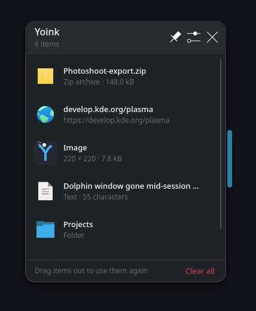
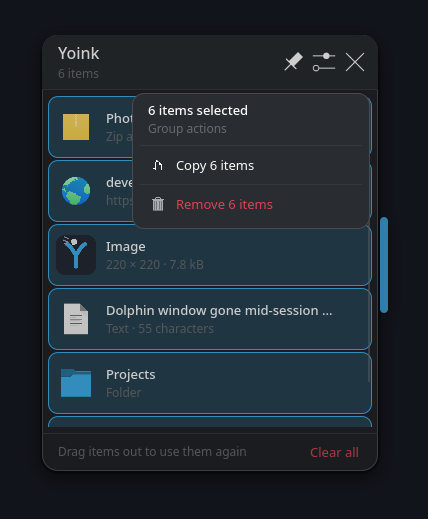
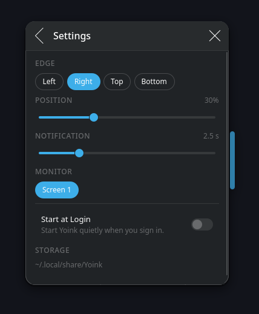
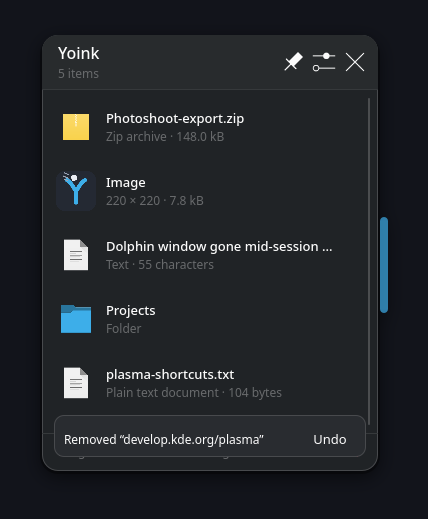

<p align="center">
  
</p>

<h1 align="center">Yoink</h1>

<p align="center">
  <em>A drag-and-drop shelf at the edge of your screen.</em><br>
  For KDE Plasma 6 on Wayland.
</p>

Yoink keeps whatever you are moving around within reach. Drag files, folders,
links, text, or images onto the thin tab at the edge of your desktop, and they
wait there until you need them again — then drag them out, open them, or copy
them with a click.

## Screenshots

<table>
  <tr>
    <td></td>
    <td></td>
  </tr>
  <tr>
    <td></td>
    <td></td>
  </tr>
</table>

## Features

- **Park anything.** Files, folders, links, text, and images are collected
  straight from drag and drop.
- **Drag it back out.** Items leave with normal copy or move semantics; Yoink
  never deletes or changes the original content.
- **Undo mistakes.** Remove items or clear the shelf, then restore the last
  removal from the toast.
- **Work with groups.** `Ctrl`/`Shift`-click to select several items, then copy,
  open, or remove them together.
- **Fits your desktop.** Follows your Plasma color scheme, fonts, and animation
  settings, including reduced motion.
- **Stays out of the way.** A nearly invisible edge tab that only appears when
  you need it, plus an optional tray icon.
- **Keyboard friendly.** Full keyboard navigation with visible focus rings.
- **Local and private.** Your shelf never leaves your machine.

## Install

One line, no root and no build tools — everything goes into `~/.local`:

```sh
curl -fsSL https://raw.githubusercontent.com/ArashKeivani/yoink/master/setup.sh | sh
```

Then launch **Yoink** from your app launcher, or run `yoink`. The shelf starts
collapsed; hover the edge tab to open it.

<details>
<summary>Installer options</summary>

- `sh setup.sh --build-from-source` — clone and build instead of downloading a
  release binary.
- `YOINK_VERSION=v1.0.0 sh setup.sh` — install a specific tagged release.
- `YOINK_PREFIX=/opt/yoink sh setup.sh` — choose a custom prefix.

</details>

Uninstall (keeps your shelf data and settings):

```sh
curl -fsSL https://raw.githubusercontent.com/ArashKeivani/yoink/master/uninstall.sh | sh
```

Add `--purge` to remove the shelf data and settings as well.

## Quick start

- On launch Yoink shows only a thin tab at the edge of your screen. Hover it to
  peek at the shelf; click it to keep the shelf open.
- Drop anything onto the shelf to collect it.
- Click an item to select it, double-click to open it. Double-clicking a text
  item copies it to the clipboard.
- Drag an item out to use it somewhere else.
- Right-click an item for open, copy, show in folder, and remove actions.
- Use the header buttons to pin the shelf open, open settings, or close it.

### Keyboard shortcuts

| Shortcut | Action |
| --- | --- |
| `Ctrl+,` | Open settings |
| `Enter` | Open the focused item |
| `Delete` | Remove the focused item |
| `Ctrl+A` | Select all items |
| `Escape` | Close the shelf or overlay, or clear the selection |
| `Ctrl+Space` | Toggle selection |
| `Shift+Space` | Extend selection |

Shortcuts work while the shelf has keyboard focus.

### Settings

Open settings from the shelf header, the tray icon, or with `yoink --settings`.

- **Edge** — attach the shelf to the left, right, top, or bottom screen edge.
- **Position** — where along that edge the tab sits. The card follows the
  slider live on the left and right edges; on the top and bottom edges the new
  position applies when you release it.
- **Notification** — how long toast messages stay visible (1–8 s).
- **Monitor** — which screen the shelf lives on.
- **Start at Login** — launch Yoink quietly when you sign in.
- **Storage** — where your shelf data lives.

### Command line

| Command | Action |
| --- | --- |
| `yoink` | Start Yoink (the shelf opens if it was pinned) |
| `yoink --show` | Show the shelf in a running instance |
| `yoink --toggle` | Toggle the shelf |
| `yoink --settings` | Open settings |
| `yoink --quit` | Quit the running instance |
| `yoink --autostart` | Start quietly, as at login |

Only one Yoink instance runs at a time; additional invocations forward their
request to it over a local socket.

## Data and settings

Your shelf is stored locally in plain files:

- Shelf items: `~/.local/share/Yoink/items.json`
- Copied images: `~/.local/share/Yoink/images/`
- Settings: `~/.config/Yoinkrc`

Files and folders on the shelf are references, not copies. If you move or
delete an original, the item is marked unavailable. The exact paths are shown in
**Settings → Storage**.

## Documentation

- [Technical notes](docs/TECHNICAL.md) — requirements, building from source,
  packaging, storage details, limits, and Wayland behavior.
- [Manual test matrix](docs/TESTING.md) — how Yoink is verified.

## License

Yoink is free software under the GNU General Public License, version 2 or
later. See [`LICENSE`](LICENSE).
